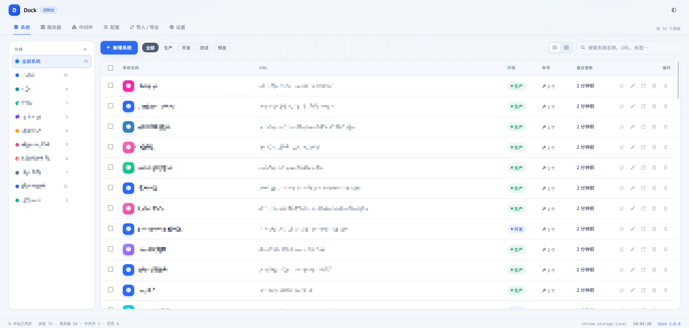
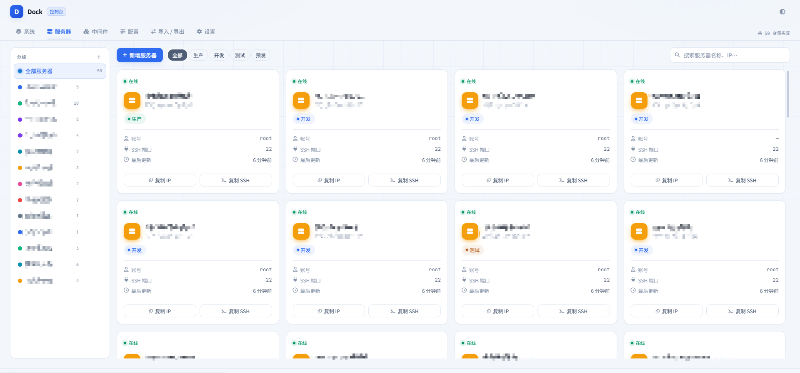
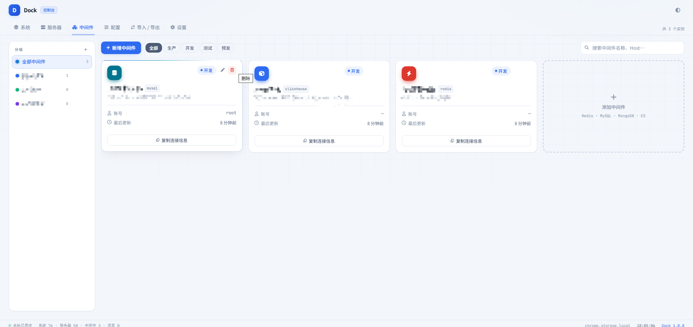
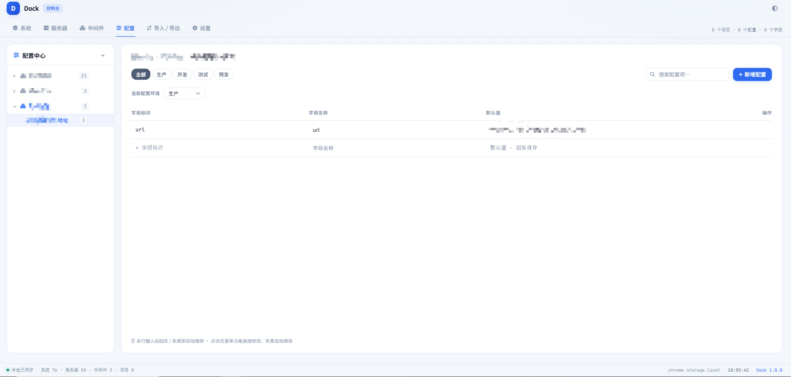
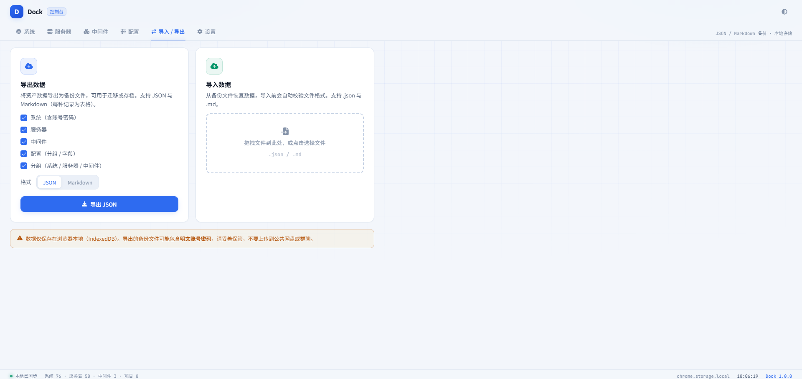
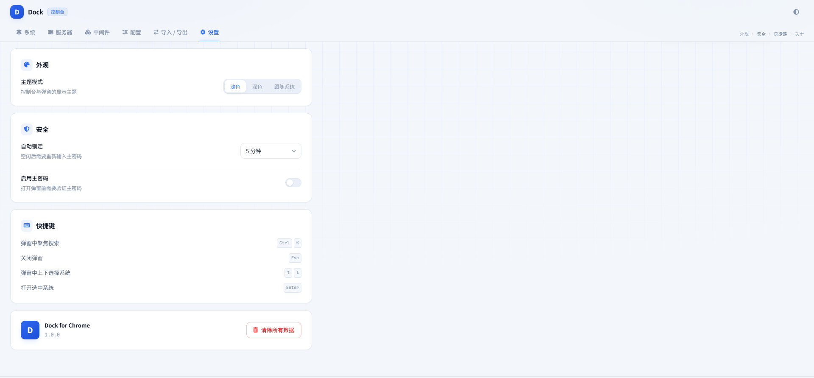

# Dock - 内部系统助手

> Chrome 扩展：一站式管理内部系统、账号、服务器、中间件、配置信息和笔记。

## 界面预览

### 系统管理



### 服务器管理



### 中间件管理



### 配置中心



### 导入导出



### 系统设置



## 功能特性

### 系统管理
- 快速收录内部系统链接，支持分组管理
- 弹窗搜索，一键直达；支持按系统名称/URL 和分组名称检索，直接命中优先，分组命中随后展示
- 标签分类，高效检索

### 账号管理
- 保存各系统的账号密码；新录入账号密码默认明文显示，保存后重新打开自动掩码
- 自动识别登录页并填充凭据：按域名/IP + 端口 + 路径（含 `#/` 路由）精确匹配，同一地址下的多个服务不会互相串用密码
- 系统有多个账号时优先填充默认账号，不再弹出账号选择；仅在没有默认账号或多个系统并列匹配时才弹出选择器
- 每个系统保证只有一个默认账号，编辑或导入时会自动校正
- AES-256 加密存储，主密码保护

### 服务器管理
- 记录服务器 IP、端口、SSH 凭据等
- 按环境（生产/开发/测试/预发）筛选
- 一键复制连接信息

### 中间件管理
- 支持 Redis、MySQL、PostgreSQL、MongoDB、Elasticsearch、RabbitMQ、Kafka、Nginx、MinIO 等
- 环境标签 + 卡片式展示
- 连接信息一键复制

### 配置中心
- 树形分组 → 配置 → 字段三级结构
- 支持拖拽调整分组顺序，配置可在分组内排序或直接拖到其他分组；拖到折叠分组标题上停留片刻会自动展开该分组
- 环境筛选状态下暂停拖拽，切回「全部」即可排序或跨组移动
- 多环境筛选（生产/开发/测试/预发）
- 拖拽排序、双击重命名、一键复制所有字段
- 支持 Markdown 格式导入导出

### 笔记
- 思源式块级 Markdown 即时渲染：`# `、`**粗体**`、列表、引用、代码块、表格、公式、任务列表等输入后立即成块，原始标记不残留
- 渲染样式对齐思源默认主题实测值：正文 16px/1.625，标题 1.75/1.55/1.38/1.25/1.13/1em（字重 600），列表 34px 标记列，引用 4px 灰条，代码块 5% 灰底 + 13.6px 等宽字体 + GitHub 高亮配色（明暗两套），表格 4×8px 单元格
- 斜杠菜单、选中浮动工具栏；表格、CodeMirror 代码块（语言选择按 A-Z 排序、带搜索，风格对齐思源）、KaTeX 公式
- 右键菜单（Typora 风格）：剪切 / 复制 / 粘贴 / 删除、复制为与粘贴为、加粗 / 斜体 / 行内代码 / 链接、引用 / 无序 / 有序 / 任务列表，以及「段落」「插入」子菜单
- 代码块内 Ctrl/Cmd+A 两段式全选（与思源一致）：第一次只选中代码块内容，再按一次选中整篇（含代码块外的正文）；正文中 Ctrl/Cmd+A 直接选中全文
- 全选不移动光标、不改变滚动位置；正文与代码块的选中色统一为 rgb(203, 216, 243)，不存在色差
- 笔记本 → 文档两级树（对齐思源文档树：文件夹/文档图标、28px 行高、操作按钮悬停出现），标题与正文自动保存，右侧大纲（可折叠收起），标题/正文搜索
- 树里的「更多」菜单带导入导出捷径：笔记本可导入单个 `.md`、把该笔记本导出为 md 的 zip；笔记可直接导出 Markdown 或 HTML
- 笔记可拖拽调整笔记本内顺序，也可直接拖到其他笔记本；拖到折叠的笔记本上停留片刻会自动展开
- 编辑区左右各留 40px 呼吸位，内容不贴面板边界
- 支持插入图片：粘贴/拖拽图片文件或点「插入图片」按钮，图片二进制存本地资源表，正文只保留 `dock-asset:<id>` 引用，随笔记一起同步、导出与版本历史；单张上限 2MB、单次同步图片总量上限 6MB
- 单篇导出（工具栏下载按钮展开菜单）：Markdown `.md`、HTML `.html`（单文件，样式对齐编辑器，本地图片内嵌为 data URL）；笔记和笔记本自动参与云端同步与版本历史
- 「导入 / 导出 → 笔记归档」支持批量导入 `.md` 文档（标题取文件名，空文件与超单篇上限的文件会跳过并可指定目标笔记本），也支持把全部笔记按「笔记本/文档.md」打包导出为 zip
- 首版不支持附件、双链、块引用和数据库视图

### 安全
- 主密码 (PBKDF2 + AES-GCM) 加密
- 自动锁定（空闲超时）
- 默认仅本地 IndexedDB 存储；开启云端同步后经 HTTPS 上传（内网 IP 可 HTTP），由服务端 AES-256-GCM 加密落盘
- 笔记正文在本地 IndexedDB 中为明文，云端随整库加密；主密码不额外加密笔记正文，敏感内容请使用 HTTPS/内网部署

### 云端同步（可选）
- 后台面板配置云端地址与 API Token，自动检测云端健康，保存后自动上传全部资产、配置和笔记
- 每次同步内容有变化时自动生成加密版本记录，可在插件设置中查看历史并恢复到指定版本
- 云端提供与插件管理面板一致的 Web 界面，支持完整增删改与自动回写
- 从云端恢复按 `updatedAt` 安全合并：新增/更新较新数据，不删除本地记录
- 账号/服务器/中间件密码、配置字段和笔记正文随快照同步；服务端加密密钥由环境变量提供
- 单个 Docker 镜像部署（Node 22 + Fastify + SQLite），Web 登录密钥与会话有效期可配置

## 技术栈

| 层级 | 技术 |
|------|------|
| 框架 | Vue 3 + TypeScript |
| 状态管理 | Pinia |
| 本地数据库 | Dexie (IndexedDB) |
| 构建工具 | Vite + @crxjs/vite-plugin |
| 路由 | Vue Router 4 |
| 拖拽排序 | vue-draggable-plus |
| 笔记编辑器 | Milkdown Crepe（ProseMirror + remark）/ KaTeX |
| 加密 | Web Crypto API (PBKDF2 / AES-GCM) |
| 云端服务 | Node 22 + Fastify + SQLite (better-sqlite3) |
| 云端面板 | Vue 3（复用管理面板）+ 内存 IndexedDB |
| 部署 | Docker 多阶段镜像 |
| 测试 | Vitest + @vue/test-utils |

## 项目结构

```
src/
├── background/       # Service Worker（快捷键、右键菜单、消息通信、云端健康检查）
├── content/          # Content Script（自动填充、页面检测）
├── dashboard/        # 管理面板（Vue SPA）
│   ├── components/   # 公共/布局/业务组件（含 notes 笔记树/编辑器/大纲）
│   ├── views/        # 路由视图
│   └── styles/       # 设计令牌 & 全局样式
├── popup/            # 弹窗（快速搜索 & 收藏）
├── web/              # 云端 Web 面板入口（复用 dashboard）
└── shared/           # 跨模块共享
    ├── crypto/       # 加密模块
    ├── db/           # Dexie 数据库 & 仓库
    ├── services/     # 业务服务层
    ├── sync/         # 云端同步（快照/恢复/调度）
    ├── stores/       # Pinia 状态
    ├── types/        # TypeScript 类型
    └── utils/        # 工具函数

shared/protocol/      # 扩展与服务端共用的同步协议
server/               # 云端 Node/Fastify 服务与 SQLite
```

## 开发

```bash
# 安装依赖
npm install

# 启动开发服务器（HMR，输出到 dist-dev/，不会覆盖生产构建 dist/）
npm run dev

# 类型检查
npm run type-check

# 构建生产版本
npm run build

# 构建云端 Web 面板
npm run build:web

# 云端服务（独立依赖）
npm --prefix server install
npm --prefix server run type-check
npm --prefix server test
npm --prefix server run build

# 运行测试
npm test

# 代码检查
npm run lint
```

## 安装到 Chrome

1. 执行 `npm run build`
2. 打开 `chrome://extensions/`
3. 开启「开发者模式」
4. 点击「加载已解压的扩展程序」，选择项目 `dist/` 目录

## 云端同步与部署

### 安全模型

- **服务端加密，不是端到端加密**：扩展在保险库解锁时通过 HTTPS 上传明文快照；服务端使用 `DOCK_DATA_KEY` 派生的 AES-256-GCM 密钥加密落盘，Web 面板登录后在内存中解密。
- **两个独立密钥**：`DOCK_ADMIN_SECRET` 只用于 Web 面板登录，`DOCK_API_TOKEN` 只用于扩展同步。修改管理员密钥会自动吊销所有 Web 会话。
- **会话有效期**：登录会话默认 30 天，可在 Web 面板「设置 → 服务端访问」调整（1–3650 天），修改后立即裁剪已有会话。
- **主密码**：扩展启用主密码时，上传/恢复要求保险库已解锁；Token 也用主密钥加密后保存在 `chrome.storage.local`。
- **版本历史**：每次变更的快照同样使用 `DOCK_DATA_KEY` 派生的密钥加密落盘；默认保留最近 100 条，可用 `DOCK_HISTORY_LIMIT` 调整。
- **传输与落盘**：域名必须使用 HTTPS；IP 地址（含内网 IP:端口）允许 HTTP，但会明文传输，仅建议内网使用；生产部署请用 Caddy/Nginx/Traefik 终止 TLS。

### Docker 部署

```bash
cp .env.example .env
# 编辑 DOCK_ADMIN_SECRET / DOCK_API_TOKEN / DOCK_DATA_KEY / DOCK_PUBLIC_ORIGIN
docker compose up -d --build
```

- 镜像默认监听 `8080`，SQLite 数据在 `/data/dock.sqlite`，使用命名卷 `dock-data` 持久化。
- 访问 `https://你的域名/`，输入 `DOCK_ADMIN_SECRET` 进入与插件一致的云端管理面板。
- 反向代理需转发到容器 `8080`；保持 `DOCK_COOKIE_SECURE=true`，并设置 `DOCK_PUBLIC_ORIGIN=https://你的域名`。
- 本地 HTTP 调试可设置 `DOCK_COOKIE_SECURE=false`、`DOCK_PUBLIC_ORIGIN=http://localhost:8080`；使用内网 IP 时填 `http://192.168.1.10:8080` 即可。
- **升级顺序**：包含笔记同步的版本请先更新服务端镜像，再更新扩展。新服务端兼容旧客户端缺少笔记表的快照；旧服务端会忽略笔记字段，升级后下一次同步会自动补齐。

### 扩展配置

1. 后台面板 → 设置 → 云端同步。
2. 填写云端地址（如 `https://dock.example.com` 或 `http://192.168.1.10:8080`）和 `DOCK_API_TOKEN`，测试连接后保存。
3. 打开「启用云端持久化」开关会立即保存配置并触发首次同步；修改地址/Token 后可点「保存配置」再同步，状态栏会显示云端状态。
4. 「从云端恢复」会按 `updatedAt` 合并云端较新数据，本地较新的记录保留，不删除本地数据；关闭持久化时也可用。
5. 关闭持久化后本地改动（包括清空）不会上传；重新开启后的首次同步不发送删除墓碑，也不会从旧基线推断删除。删除只有在持久化开启时才会同步到云端。
6. 「覆盖云端」仅在持久化开启时可用：以本地数据为准全量上传，删除云端独有记录，用于修复两端数据不一致。
7. 「版本历史」在每次同步内容有变化时自动生成版本（含变更统计与快照）。选择「恢复」会用该版本替换本地数据；持久化开启时会同时覆盖云端，且云端会再记录一条恢复版本。若目标版本不包含笔记，恢复前会额外提示本地笔记将被删除。
8. 笔记编辑保存在本地后自动标记待同步；单篇正文限制 262,144 字符，全部笔记正文合计约 6MB；超限时本地仍保留，但云端同步会报错，需要精简后再同步。

### 备份与密钥轮换

- 备份：停止容器后复制 `/data/dock.sqlite`（包含 WAL 时一并复制），或在运行中用 SQLite `VACUUM INTO`。
- 轮换数据密钥：设置新的 `DOCK_DATA_KEY`，同时把旧值放入 `DOCK_DATA_KEY_OLD` 启动一次；服务会用新密钥重加密当前状态与全部历史版本并退出旧密钥状态。两项都不匹配时容器会拒绝启动，避免覆盖数据。
- 修改 `DOCK_ADMIN_SECRET` 或 `DOCK_API_TOKEN` 后重启容器即可生效。

### 已知限制

- 笔记首版不支持图片/附件、双链、块引用、数据库视图；仅支持「笔记本 → 文档」两级结构。
- 多行 GFM 管表不会逐字即时转换；请用斜杠菜单插入表格，或输入 `|2x2|` 快捷创建。
- 笔记正文超过 262,144 字符或所有笔记正文合计超过约 6MB 时无法同步；本地数据仍会保留，按提示精简后再同步。
- Crepe 的表格、代码块等局部按钮可能仍显示英文（如 Copy、语言选择），不影响编辑。
- 笔记正文在本地 IndexedDB 中为明文，未使用主密码额外加密；需要更高保密性时请使用 HTTPS/内网部署。
- Web 面板使用内存 IndexedDB：刷新会重新从云端加载，关闭标签会丢弃尚未推送的编辑（有 2 秒防抖和 `pagehide` 尽力推送）。
- 自动同步在打开的后台面板中执行；弹窗新增的数据会先记为待同步，下次打开后台面板时上传。
- 版本历史默认保留最近 100 条（`DOCK_HISTORY_LIMIT` 可调），超出后自动清理最旧版本；每条版本保存一份完整加密快照。笔记正文会放大版本体积，笔记较多时建议下调该值（例如 20–30）。
- 冲突按整条记录 `updatedAt` 后写胜出；同一记录不同字段的并发编辑可能丢失较旧的一次。笔记编辑页会检测远端更新并提示「覆盖保存 / 加载云端」。
- 单进程 SQLite，不支持多副本水平扩展。
- 云端 API Token 使用主密码加密保存在本地；修改或关闭主密码后需要重新输入 Token。

## 快捷键

| 快捷键 | 功能 |
|--------|------|
| `Ctrl+Shift+K` | 打开弹窗 |
| `Ctrl+Shift+L` | 自动填充当前页面凭据 |
| `Ctrl+K` | 弹窗中聚焦搜索 |
| `Esc` | 关闭弹窗 |

## 数据导入导出

- 支持 Markdown 格式导入/导出结构化资产（系统、服务器、中间件、配置）
- 支持 JSON 格式完整备份与恢复，包含笔记/笔记本和正文
- Markdown 结构化备份不包含笔记正文（避免正文中的 `##` 破坏分段）；请在笔记页单篇导出 Markdown，或使用 JSON 备份
- 云端同步支持按 `updatedAt` 差异化恢复，本地较新的记录不会被覆盖

## License

MIT
